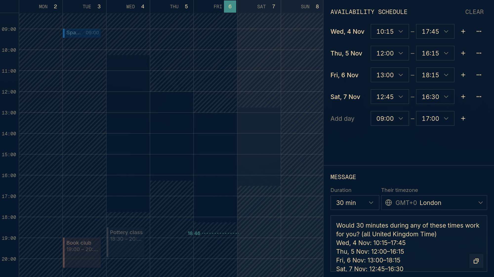

# renCal Availability view

A [renCal](https://rencal.org) view for offering someone times to meet. Pick times on a week grid and get a message ready to paste, in their timezone.



- **Grid:** your week with events dimmed behind it. Drag on a day to pick a time; everything you haven't picked stays hatched.
- **Panel:** edit the picked times, add days, set the meeting length and the recipient's timezone.
- **Message:** click it to copy.

Picks last until you quit renCal. Nothing is saved or sent anywhere: the view only reads your events and writes to your clipboard.

## Installation

Add the repository to `~/.config/rencal/plugins.toml`:

```toml
plugins = ["t4t5/rencal-view-availability"]
```

Give it a key in `~/.config/rencal/keys.toml`:

```toml
f = "view.switch:t4t5.availability/availability"
```

## Development

```sh
pnpm install
pnpm test
pnpm build
```

Add the checkout to `~/.config/rencal/plugins.toml` to try it, and renCal reloads it on every build. `dist/` is not committed: renCal installs the built files from the latest GitHub release.

The SDK only exists inside renCal at runtime, so tests run against the small stand-in in `test/sdk.tsx`.

## Releasing

Push a version tag:

```sh
git tag v0.1.0
git push origin v0.1.0
```

The [release workflow](.github/workflows/release.yml) builds the view and publishes a release with `dist/availability.js` and `dist/availability.css` attached for every `v*` tag. renCal installs the latest release and shows its tag as the version.
